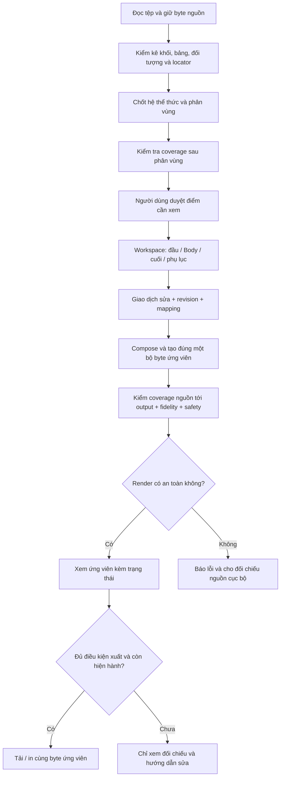

# Đề xuất hoàn thiện luồng xử lý dữ liệu DocForm

- Ngày: 03/11/2026.
- Trạng thái: **PROPOSED — chưa triển khai, chưa nghiệm thu**.
- Cơ sở: checkout `D:\DocForm`, main `4c3751f` cùng thay đổi local; [báo cáo audit pipeline](DOCFORM_DOCUMENT_STRUCTURE_PIPELINE_AUDIT_2026-11-03.md), mã nguồn hiện hành và kết quả pilot đã ghi trong báo cáo đó.
- Đầu ra mong muốn: nhân viên hành chính tải tài liệu, duyệt các điểm cần xem, sửa đầu–thân–cuối riêng, xem bản dựng và tải/in đúng bản đang xem. Ưu tiên desktop/PC.
- Tài liệu này đề xuất thiết kế và thứ tự thực hiện; không xác nhận các cơ chế đề xuất đã có trong sản phẩm. Không đưa nội dung tài liệu nội bộ vào ví dụ.

## 1. Quyết định kiến trúc đề xuất

Giữ pipeline hiện tại và bổ sung **bản đồ bảo toàn nguồn xuyên suốt**: mỗi phần tử nguồn phải có vị trí tiếp nhận hoặc quyết định biến đổi cụ thể, từ lúc phân vùng đến DOCX cuối. Dữ liệu đầu/cuối được sửa bằng form riêng; cấu trúc nguồn của chúng vẫn được giữ làm bằng chứng và đầu vào xuất khi được hỗ trợ.

Không thay toàn bộ parser/editor/exporter trong một đợt. Sửa lỗi mất nội dung trước, rồi mở rộng khả năng giữ cấu trúc và cải thiện trải nghiệm xem/đối chiếu.

| Phương án | Ưu điểm | Chi phí/rủi ro | Đánh giá |
|---|---|---|---|
| Chỉ sửa từng regex, con trỏ và câu cảnh báo | Nhanh cho ca đang lỗi | Không phát hiện lỗi mất khối ở vị trí mới; vẫn có thể báo an toàn khi working state đã thiếu nguồn | Chỉ dùng như bản sửa khẩn cấp kèm gate bao phủ |
| Mô hình có cấu trúc + provenance + bản đồ biến đổi, mở rộng trên pipeline hiện có | Giữ form đầu/cuối, sửa được nội dung, kiểm tra mất/nhân đôi và hỗ trợ dần các cấu trúc | Cần hợp đồng mapping và test qua nhiều lớp | **Khuyến nghị** |
| Dùng engine Office để sửa trực tiếp toàn bộ gói DOCX | Có tiềm năng giữ nhiều cấu trúc phức tạp | Đổi nền tảng editor, giao dịch, tích hợp và nghiệm thu; vẫn cần provenance và kiểm tra bố cục | Nghiên cứu riêng sau khi pipeline hiện tại ổn định |

## 2. Bất biến cần bổ sung

1. Mỗi khối vật lý có đúng một vùng sở hữu chính: đầu, thân, cuối, phụ lục hoặc chưa xác định. Một bảng vật lý có thể có nhiều ánh xạ ngữ nghĩa theo ô; không nhân bản bảng khi một ô chứa nơi nhận và ô khác chứa người ký.
2. Mỗi phần tử có ý nghĩa trong khối phải được giữ, thay thế có bằng chứng hoặc được người dùng quyết định xử lý. Việc ID còn trong danh sách review không chứng minh nội dung đã tới bản xuất.
3. Các trường form là cách sửa/chiếu dữ liệu. Form và bảng nguồn không trở thành hai bản nội dung độc lập được xuất cùng lúc.
4. Không dùng phép tìm chuỗi đơn giản làm bằng chứng duy nhất cho coverage. Hai đoạn cùng chữ vẫn là hai phần tử nguồn khác nhau; một paragraph có thể có nhiều run, field, line hoặc đối tượng.
5. Việc biến đổi hợp lệ phải gắn nguồn, mục đích, hệ thể thức, profile và phiên bản phép biến đổi. Khi phụ thuộc thay đổi, kết quả và phê duyệt liên quan trở thành stale.
6. Giữ nguồn thiếu/chưa rõ là thiếu/chưa rõ. Không tự điền số văn bản, ngày hoặc người ký để làm xanh chỉ số.

## 3. Mô hình dữ liệu đích

Tận dụng `SourceBlock`, `StructuredImport`, `WorkspaceSnapshot`, `TableModel` và ledger hiện có. Chỉ thêm mô hình ở nơi thiếu; tránh tạo kho tài liệu song song.

| Thành phần đề xuất | Nội dung tối thiểu | Mục đích |
|---|---|---|
| Source inventory bất biến | Hash/generation; package part; block/ô/run/object locator; thứ tự; loại phần tử; dữ liệu cấu trúc cần thiết | Biết nguồn thực sự có gì, kể cả đối tượng không có text |
| Region assignment | Khối vật lý → vùng chính; ánh xạ field/ô con; bằng chứng và trạng thái cần duyệt | Tách quyền sở hữu vật lý với cách hiểu ngữ nghĩa |
| Transformation map | Source locator(s) → target node/field/object(s); thao tác; lý do; phiên bản; quyết định xác nhận khi cần | Giải thích mỗi phần tử đi đâu và vì sao thay đổi |
| Region representation | Fields + source layout/table + cách dựng đang chọn cho phần đầu/cuối | Sửa bằng form nhưng không đánh rơi bố cục nguồn |
| Coverage report | Mục được giữ/biến đổi/chưa giải quyết/mất/nhân đôi; locator nguồn và đích | Chặn silent omission trước khi xuất |
| Candidate evidence | Snapshot key/revision; byte SHA; mapping xuất; coverage/content/table/object/safety results | Preview, tải và in cùng đối tượng hiện hành |

Các tên trên là hợp đồng thiết kế, chưa phải type/API đã tồn tại. Locator phải phân biệt table vật lý với alias trong `importedTables`; không đếm alias như hai bảng.

Mapping có thể nhiều nguồn → một đích khi có phép hợp nhất được định nghĩa, hoặc một nguồn → nhiều field theo ô. Cần kiểm soát rõ để không nhầm với nhân đôi đầu ra. Đối tượng do profile tự sinh phải có nguồn gốc `generated_by_profile`, không giả mạo là đối tượng đã được giữ từ tài liệu tải lên.

## 4. Luồng đích từ nhập đến xuất

### 4.1 Đọc nguồn và commit phiên nhập

- Đọc/trích nguồn trong phiên pending; giữ hành vi token chống upload cũ ghi đè nguồn mới.
- Chốt hệ thể thức theo cơ chế hiện hành; khi xung đột/không đủ bằng chứng, yêu cầu người dùng xác nhận bằng ngôn ngữ thông thường.
- Kiểm kê đối tượng theo loại: line/shape, picture, textbox, field, relationship, bảng lồng… Không gọi chung mọi `drawing_or_image` là “hình ảnh”.
- Chỉ thay phiên đang làm sau khi trích/phân vùng/kiểm tra cơ bản thành công. Lỗi hoặc hủy giữ tài liệu trước đó; blob đã lưu nhưng không được commit phải có chính sách thu gom, không xóa blob đang được lịch sử tham chiếu.
- Trạng thái lưu nguồn `indexeddb`/`memory` cần rõ; không hứa còn nguồn sau tải lại nếu chỉ giữ trong phiên.

### 4.2 Phân vùng và duyệt Bước 1

- Giữ raw blocks; phân vùng tạo projection và mapping, không cắt mất nguồn.
- Chạy coverage ngay sau segmenter và sau mỗi lần người dùng đổi vùng. Khối role `body` vắng khỏi Body IDs/HTML phải bị báo trước khi duyệt.
- Vùng mơ hồ đưa vào “Cần xác định vị trí”; không ép vào Body để đủ phân loại. Giữ nguyên nguồn và giải thích tác động tới khả năng xuất.
- Một bảng trộn cả nội dung Body và phần cuối chưa được hỗ trợ chia vùng phải giữ nguyên vật lý, đánh dấu cần duyệt. Không tự chuyển cả bảng thành chữ ký chỉ vì có một ô giống công thức ký.
- Nhãn bảng cuối nên là “Nơi nhận và người ký”, có mô tả ánh xạ ô khi mở chi tiết. Giữ mã block/feature kỹ thuật trong ngăn chi tiết.

### 4.3 Soạn và cập nhật đồng bộ

- Nhóm 01–05 và 07–09 dùng form riêng; nhóm 06 chỉ chứa Body. Phụ lục có canvas riêng.
- Chỉnh field đầu/cuối tạo một giao dịch, cập nhật giá trị và mapping xuất dự kiến. Không sửa source evidence; không để form mới và `signatureHtml`/bảng cũ xuất hai bản.
- Chỉnh ô Body phải đồng bộ HTML, `TableModel`, node và revision trong cùng giao dịch; thất bại thì rollback toàn bộ giao dịch.
- Chỉnh source role, hệ, profile hoặc layout làm candidate cũ stale. Chỉ vô hiệu quyết định phụ thuộc vào thay đổi đó; không xóa mọi lựa chọn người dùng nếu không cần.
- AI dùng anchor/mapping hiện hành, gợi ý có before/after và chỉ áp dụng qua giao dịch sau khi duyệt. AI không được gỡ blocker coverage hoặc thay consent.

## 5. Cách xử lý đầu và cuối văn bản

Mỗi vùng có hai cách dựng được kiểm soát trong cùng mô hình. Không để exporter âm thầm đổi profile chỉ vì tên cơ quan khớp heuristic; phải sử dụng quyết định profile hiện hành, có dấu vết.

| Cách dựng | Áp dụng | Điều phải chứng minh |
|---|---|---|
| Giữ cấu trúc nguồn được hỗ trợ | Bảng đầu/cuối đủ model và khả năng roundtrip | Giữ thứ tự, ô gộp, độ rộng, viền, căn lề, khoảng trống được hỗ trợ; sửa field cập nhật đúng locator |
| Dựng theo mẫu/profile đã chọn | Người dùng chọn chuẩn hóa hoặc có quyết định profile hợp lệ | Nội dung field được giữ; bố cục nào thay đổi được nêu trước; đối tượng nguồn được giữ/thay thế có mapping rõ |

Khuyến nghị mặc định bảo toàn cấu trúc vùng nguồn nếu đã được chứng minh hỗ trợ. Nếu chưa hỗ trợ, tiếp tục giữ byte gốc, cho đối chiếu và báo giới hạn; không tự hạ cấp thành text rồi cho tải bản biến đổi.

Đưa bảng nơi nhận/chữ ký ra khỏi Body **không đồng nghĩa** đưa bảng đó vào Word page footer lặp theo trang. Đây là vùng cuối của nội dung văn bản chính. Header/footer thực sự của Word cần kiểm kê và chính sách hỗ trợ riêng.

Không cam kết tái tạo mọi hình học chỉ vì đã có `TableModel`. Phần tử chưa mô hình hóa phải còn trong inventory và giữ blocker. Muốn dùng raw OOXML cần adapter có phạm vi rõ, kiểm relationship/content type/namespace/ID, vô hiệu nội dung hoạt động và kiểm byte output; không ghép fragment tùy ý.

## 6. Đường kẻ, Shape, dấu sao và dấu gạch

| Loại | Đề xuất xử lý | Khi phải cần duyệt/chặn |
|---|---|---|
| Paragraph chỉ có `-----`, `- - -`, `___`, `* * *` | Giữ locator, vị trí và số lượng. Chỉ thay bằng separator profile khi đúng vai trò/vị trí và có mapping biến đổi | Chưa phân biệt được trang trí hay nội dung; hoặc nhiều nguồn bị gộp mà không có quyết định |
| Dấu `*` ở đầu trang Đảng | Giữ thuộc vùng đầu đúng hệ và vị trí; không dùng quy tắc separator Body chung | Hệ chưa xác nhận hoặc vị trí mâu thuẫn |
| Gạch đầu dòng thật | Giữ list properties/paragraph; không coi mọi dấu `-` là separator | Parser không giữ được numbering/list semantics |
| Paragraph border / table border | Kiểm kê như thuộc tính cấu trúc, không tạo thêm text gạch | Thuộc tính chưa được model/export hỗ trợ |
| Shape line DrawingML/VML | Đọc loại đối tượng, hình học, anchor, style và fallback; tái tạo/giữ qua adapter đã hỗ trợ | Sai khác hoặc loại chưa hỗ trợ; không nới gate chỉ để pilot xanh |
| Ảnh, textbox, đối tượng khác | Giữ danh tính/locator, phân loại đúng; chỉ cho xuất khi có đường xử lý được chứng minh | Có nội dung chưa được giữ hoặc nội dung hoạt động không an toàn |

Không dùng riêng `cy=0` để kết luận là line an toàn. Một đường hơi nghiêng có thể hợp lệ, nhưng cần xác định hình học, loại Shape, DrawingML/VML fallback và các thành phần nhúng. Ngưỡng hỗ trợ phải dựa trên fixture và sai số được công bố, không chọn số tùy ý theo một pilot.

Sửa khẩn cấp: giữ separator NĐ30 sau trích yếu trong Body, và HD05 chỉ thay đúng separator thuộc trích yếu; các separator giữa Body phải còn nguyên. Kèm test nguồn→workspace→DOCX để tránh sửa được UI nhưng mất ở exporter.

## 7. Coverage và cổng ứng viên

Hai lớp coverage cần chạy độc lập:

1. **Nguồn → workspace:** mọi phần tử đã phân vùng có đích hoặc phép biến đổi được khai báo; phát hiện thiếu, trùng, sai thứ tự và trạng thái chưa xử lý.
2. **Workspace + mapping → byte DOCX:** mọi node/field/object được xuất vào đúng vùng; kiểm trực tiếp XML/relationships từ byte ứng viên. Không chỉ tin mapping do composer tự khai đã đầy đủ.

Chỉ bỏ qua dữ liệu kỹ thuật không có nội dung khi có quy tắc rõ. Đoạn rỗng, khoảng trống ký và ngắt trang có thể ảnh hưởng bố cục; không đánh đồng tất cả với dữ liệu vô nghĩa. Không cung cấp nút “Bỏ qua toàn bộ lỗi” để cho phép mất nội dung.

| Trạng thái/khả năng đề xuất | Nghĩa và tác động |
|---|---|
| Có thể render an toàn | Gói đọc được, qua kiểm tra nội dung hoạt động/resource và renderer được cô lập. Cho xem đối chiếu dù fidelity chưa đạt |
| Coverage/fidelity chưa đạt | Có phần mất, thay đổi chưa giải thích hoặc chưa hỗ trợ. Cho chẩn đoán nếu render an toàn; khóa tải/in ứng viên |
| Số/ngày đang để trống | Thông tin bản nháp cần hoàn thiện; hiển thị nhắc đúng vị trí. Không đồng nhất với lỗi mất dữ liệu hoặc không an toàn |
| Candidate hiện hành và đủ gate xuất | Cho tải/in, kiểm lại snapshot/revision/hash ở thời điểm thực hiện |
| Stale hoặc không an toàn để render | Không mount bản cũ/không an toàn; cho tạo lại hoặc đối chiếu nguồn cục bộ |

Các capability có thể biểu diễn bằng tên như `canRenderDiagnostic`, `canDownload`, `canPrint`; không thay nghĩa `safe` bằng cách mở tải cho ứng viên fidelity lỗi. Preview chẩn đoán cần gỡ các lối tải/in trực tiếp từ renderer và có nhãn dễ thấy “Bản đối chiếu — chưa đủ điều kiện xuất”.

Xem, tải và in phải dùng cùng bytes/SHA hiện hành. Khi đang tạo ứng viên mới, hủy mount cũ hoặc giữ bản cũ chỉ khi ghi rõ revision và khóa thao tác gây nhầm. Không tạo DOCX lần hai riêng cho print. Kiểm Word/LibreOffice vẫn là bước đánh giá bố cục độc lập.

## 8. Trải nghiệm dành cho nhân viên hành chính

- Bước 1 mặc định chỉ cho biết tệp đã đọc và có bao nhiêu điểm cần xem. Khi không có vấn đề, không hiện khối hướng dẫn kỹ thuật.
- Mỗi vấn đề có vùng, mô tả tác động và thao tác cụ thể: “Đường kẻ dưới trích yếu chưa được giữ”, “Xem vị trí”, “Đối chiếu tệp gốc”. Nhóm theo vấn đề gốc để tránh đếm blocker và thông báo reject tổng quát thành hai lỗi.
- Bảng phân vùng và mã kỹ thuật mở khi cần. Không buộc người dùng hiểu `SourceBlock`, `drawing_or_image`, fingerprint hoặc JSON.
- Đổi vùng có preview tác động và hoàn tác. Quay lại bước nhỏ chỉ vào bước đủ điều kiện, không tự duyệt các bước bị bỏ qua.
- Bước 3 cho nhìn bản dựng an toàn kèm lỗi theo vị trí; tránh màn trắng khiến người dùng không biết sửa ở đâu. Nút “Quay lại sửa” dẫn đúng field/vùng.
- Chỉ đưa tùy chọn AI ra khi có tác vụ cần hỗ trợ; kết nối provider không tự gửi tài liệu và không thay bước duyệt nguồn.

## 9. Thứ tự triển khai và tiêu chí nghiệm thu

| Đợt | Thay đổi | Vùng mã bắt đầu | Điều kiện hoàn tất |
|---|---|---|---|
| A — Bịt mất dữ liệu | Sửa separator NĐ30/HD05; coverage nguồn→workspace; đồng bộ contract footer và test legacy | `structuralSegmenter`, `separator`, `importReview`, `workspaceState`, transactions | Các chuỗi separator ở nhiều vị trí không mất/nhân đôi; cố tình xóa mapping phải chặn; pilot footer ngoài Body từ B1→B2 |
| B — Mapping tới output | Schema mapping, region layout và export mapping; kiểm candidate từ byte | shared schemas, `documentComposer`, `docxExport`, `exportCandidate` | Mỗi field/paragraph/bảng/object có đích hợp lệ; thiếu nguồn dù working HTML tự nhất quán vẫn FAIL |
| C — Đầu/cuối và đồ họa | Adapter bảng cuối/đầu, line Shape và chọn giữ nguồn/dựng profile | `embeddedSignatureTable`, `sourceHeaderShapes`, header stamp, composer/exporter | Fixture đủ kiểu hỗ trợ; số lượng/vị trí/geometry trong phạm vi giữ đúng; loại chưa hỗ trợ tiếp tục khóa |
| D — Preview chẩn đoán | Capability render riêng, lỗi theo vị trí và cùng byte tải/in | `WorkspaceExport`, `A4DocumentPreview`, `CandidatePrintView` | Candidate fidelity lỗi nhưng render an toàn xem được, tải/in bị khóa; candidate unsafe/stale không render; không có đường vòng xuất |
| E — Nghiệm thu desktop | Pilot tổng hợp và tệp thật cục bộ, phục hồi phiên, Word/LibreOffice | Test/browser harness và màn hình B1–B3 | Hoàn thành ma trận ở mục 10, ghi rõ trạng thái cấu trúc/hiển thị/Word riêng |

Dependency: A trước B; B trước khi công bố C giữ đủ nguồn; D có thể chuẩn bị riêng nhưng phải dùng evidence/capability thống nhất. Không dồn cả đợt thành một thay đổi lớn. Mỗi đợt cần diff review, lint và test đúng phạm vi. Main vận hành giữ cổng 5050; server kiểm thử dùng cổng riêng và được dừng sau test.

## 10. Ma trận kiểm thử bắt buộc trước khi chấp nhận

| Nhóm | Ca cần có | Bằng chứng yêu cầu |
|---|---|---|
| Coverage | Bỏ paragraph trước compose, ID còn trong review; đoạn trùng text; block nhiều object; cố ý nhân đôi | Gate phát hiện từ locator/mapping và byte output, không phụ thuộc text includes |
| Separator | NĐ30/HD05, công văn/không công văn; một/nhiều dấu; đầu/sau trích yếu/giữa Body/cuối | Số lượng, thứ tự, role, Body IDs, XML output và preview |
| Đầu/cuối | Bảng/paragraph; bảng cuối 1×2; ô gộp; nhiều đoạn/ô; nhiều người ký; chưa có người ký | Đúng vùng; không nhân đôi; không tự tạo dữ liệu; mapping field/ô và fidelity cấu trúc |
| Mixed/unknown | Một bảng trộn Body–ký; bảng trong phụ lục giống chữ ký; khối không xác định | Không đoán sai; giữ nguồn, yêu cầu duyệt và chặn phù hợp |
| Đồ họa | Line ngang/hơi nghiêng, DrawingML/VML/AlternateContent, border, picture, textbox, quan hệ ngoài | Hỗ trợ đúng loại; đối tượng unsupported/unsafe không được bỏ qua gate |
| Giao dịch | Sửa field/ô, đổi role/profile/hệ, undo/redo, khôi phục draft cũ | Một nguồn sự thật, revision và mapping nhất quán; approvals/candidate phụ thuộc thành stale |
| Upload | A→B đang chạy; tệp hỏng; hủy; lỗi lưu IndexedDB; reload | Không ghi đè A ngoài ý muốn; nguồn gốc còn đúng; không giữ approval cũ cho B |
| Candidate | Preview diagnostic, safe, stale, unsafe; thay đổi khi chờ font/in | SHA và snapshot nhất quán; không tải/in qua đường vòng; lỗi hiển thị có tác động đúng |
| UX desktop | Nhân viên mở tệp, xem cảnh báo, sửa đúng vùng, quay lại và xuất | Luồng thao tác thực; nút có ích; chi tiết kỹ thuật mặc định đóng; không có màn trắng vô nghĩa |
| Office | DOCX cùng byte được mở Word và LibreOffice, bản in tham khảo trình duyệt | Đối chiếu trang/viền/đường kẻ/ngắt trang/vùng ký; ghi sai khác và giới hạn, không suy từ XML PASS |

Fixture mới phải là tổng hợp/đã khử nhận dạng; tệp pilot thật chỉ chạy cục bộ. Tài liệu này không chạy lại test vì chưa có thay đổi code. Các PASS/FAIL đã tái hiện nằm trong báo cáo audit, không phải trạng thái nghiệm thu thiết kế mới.

## 11. Chuyển đổi phiên cũ và triển khai an toàn

- Thêm schema version cho mapping/coverage. Phiên cũ không có mapping được gắn `needs_revalidation`, không tự cấp approval/candidate hợp lệ.
- Dựng lại mapping từ nguồn còn lưu theo đúng hash; so với bản làm việc và ledger. Nếu nguồn thiếu hoặc không khớp, giữ draft để xem/sửa nhưng báo chưa chứng minh được roundtrip, hướng dẫn nạp lại đúng nguồn.
- Không di chuyển footer cũ bằng regex trực tiếp trên HTML rồi xóa. Dùng source table IDs/locators và xác nhận khi mơ hồ; giao dịch phải undo được.
- Có thể chạy coverage mới ở chế độ so sánh nội bộ trong giai đoạn phát triển. Khi phát hiện mất nguồn thật, vẫn phải chặn xuất theo lỗi đã biết; không dùng chế độ so sánh để hợp thức hóa false pass.
- Log chỉ chứa mã lỗi, locator kỹ thuật và metadata cần thiết, tránh nội dung/credential; mọi artifact debug chứa tài liệu phải ở kho cục bộ được kiểm soát.

## 12. Phạm vi sửa đầu tiên được khuyến nghị

Bắt đầu đợt A: sửa mất separator và bổ sung kiểm tra bao phủ nguồn ngay sau phân vùng/approval; đồng thời sửa test footer legacy để yêu cầu nơi nhận/chữ ký ở phần cuối. Đây là nền tảng để đợt B chứng minh dữ liệu tới DOCX, rồi mới mở rộng giữ Shape/bố cục và preview chẩn đoán.

Điều kiện dừng đợt A: tái hiện cũ phải chuyển từ candidate `safe=true` khi mất separator sang lỗi coverage rõ ràng; ca hợp lệ giữ đủ dấu phải xuất được trong phạm vi hỗ trợ. Không gỡ blocker Shape của pilot cho đến khi có adapter và bằng chứng output tương ứng.

## Tài liệu và điểm đối chiếu

- [Audit pipeline và các reproduction hiện hành](DOCFORM_DOCUMENT_STRUCTURE_PIPELINE_AUDIT_2026-11-03.md).
- [Codebase Map](CODEBASE_MAP.md): mục 2, 3, 7, 8, 9 và 11.
- [Workspace và invariant hiện tại](../src/utils/workspaceState.ts).
- [Ghép cấu trúc để xuất](../src/utils/documentComposer.ts).
- [Gate ứng viên hiện tại](../src/utils/exportCandidate.ts).
- [Giao diện xem/xuất hiện tại](../src/components/WorkspaceExport.tsx).
