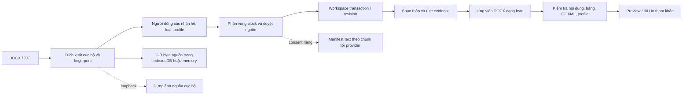

# Đánh giá chi tiết dự án DocForm-30

**Ngày đánh giá:** 02-11-2026

**Checkout:** `D:\DocForm`, nhánh `main`, `HEAD=fe854c6` (`origin/main` cùng commit; `git rev-list --left-right --count HEAD...origin/main` trả `0 0`).
**Phạm vi:** mã nguồn, hợp đồng dữ liệu, cấu hình server, tài liệu kỹ thuật, test và các thay đổi local đang có.

## Kết luận điều hành

DocForm-30 là một ứng dụng biên tập tài liệu hành chính/văn bản Đảng có định hướng bảo vệ nguồn tốt: tách hai hệ thể thức, giữ byte nguồn, yêu cầu người dùng xác nhận các quyết định quan trọng, gắn đề xuất AI với nguồn, và dựng DOCX ứng viên qua các cổng kiểm tra. Luồng sản phẩm chính đã được triển khai trong wizard ba bước.

Đánh giá tổng thể: **NEEDS_REVIEW — phù hợp cho pilot cục bộ có kiểm soát sau khi xử lý cấu hình mạng; chưa có đủ bằng chứng để coi là sẵn sàng triển khai rộng hoặc phát hành văn bản chính thức.** Có một cấu hình mặc định làm server nghe trên mọi giao diện mạng và CORS cho phép mọi origin khi không cấu hình allowlist. Một API dùng Gemini không có chốt local-only tương ứng. Ngoài ra, nhánh trạng thái ứng viên đang gộp `safe` với `downloadable`, trái với hợp đồng được ghi trong hướng dẫn dự án.

Đây là đánh giá source-level. Trong lượt này **không chạy test, lint/build, server, browser, Microsoft Word/LibreOffice, provider thật hoặc thẩm định pháp lý độc lập**. Vì vậy trạng thái các xác nhận runtime, hiển thị trang, chất lượng provider và hiệu lực/nội dung pháp lý đều là `NOT_EVALUATED` hoặc `NEEDS_REVIEW`, không phải `PASS`.

## Kiến trúc và luồng hiện hành

Luồng UI hiện hành ở [App.tsx](../src/App.tsx#L1374) và các view được nối tại [App.tsx](../src/App.tsx#L3875): bước 1 nhập/nhận diện/duyệt nguồn; bước 2 soạn; bước 3 xem và xuất. File được phân tích trong trình duyệt qua `extractLocalFile`; thao tác upload hiện hành sau đó tách riêng bước xác nhận hệ và phân vùng. Byte nguồn được lưu bằng kho `source_blobs`, có thể là IndexedDB hoặc bộ nhớ phiên và trạng thái lưu được biểu thị cho người dùng ([localFileImport.ts](../src/utils/localFileImport.ts#L44), [draftStore.ts](../src/utils/draftStore.ts#L96)).

Workspace dùng transaction có kiểm tra revision và invariant; thao tác sửa làm tăng revision và khiến ứng viên cũ mất hiệu lực ([workspaceTransactions.ts](../src/utils/workspaceTransactions.ts#L78), [exportCandidate.ts](../src/utils/exportCandidate.ts#L152)). Ứng viên được tạo một lần, hash SHA-256, kiểm tra fidelity bảng/nội dung và an toàn export trên cùng byte đầu ra ([exportCandidate.ts](../src/utils/exportCandidate.ts#L45)). Download và print kiểm tra candidate hiện hành; print nhận `current.bytes` và recheck tính hiện hành trong lúc dựng trang ([App.tsx](../src/App.tsx#L3514)).

## Đánh giá theo năng lực

| Phân vùng | Đánh giá hiện tại | Giới hạn chính |
|---|---|---|
| Nguồn và nhập liệu | **Thiết kế tốt, triển khai cục bộ** | Heuristic phân đoạn vẫn cần mẫu âm/dương đa dạng và kiểm chứng bằng DOCX thực tế. |
| NĐ 30 / Hướng dẫn 05 | **Có tách hệ và registry** | Catalog được nạp từ JSON; đánh giá này không xác nhận nội dung catalog còn hiệu lực hoặc được chuyên gia pháp lý phê duyệt. |
| Rule và evidence | **Có trạng thái phân biệt** | Code có `PASS`, `FAIL`, `NOT_EVALUATED`, `NEEDS_REVIEW`, `NOT_APPLICABLE`; chưa chạy suite và chưa xác nhận cách diễn giải pháp lý. |
| Rà soát AI | **Có consent, fingerprint, coverage** | Luồng toàn văn gửi text trích xuất tới provider đã chọn; capability không chứng minh provider đã đọc đủ. Provider thật chưa được thử. |
| Lưu trữ | **Lưu nháp và byte nguồn ở browser** | IndexedDB thuộc profile trình duyệt; không phải kho mã hóa/backup nhiều người dùng. `documentSessionStore` có code riêng nhưng chưa được nối vào UI hiện hành. |
| Xuất DOCX | **Có cổng fail-closed và định danh ứng viên** | Hỗ trợ OOXML có giới hạn; `safe`/`downloadable` hiện bị gộp. Dàn trang Word thực tế chưa được duyệt trong lượt này. |
| Kiểm thử | **Nhiều test theo feature** | Có 117 tệp `*.test.ts`, nhưng `npm test` chỉ chạy `test/nd30-compliance.test.ts`; không tìm thấy cấu hình CI trong checkout. Không test nào được chạy trong lượt đánh giá. |
| Vận hành/bảo mật | **Có giới hạn file, rate limit và một số chốt loopback** | Mặc định bind/CORS và API Gemini cần được xử lý trước khi chạy trên mạng không tin cậy. |

### Điểm mạnh có bằng chứng trong mã

1. **Giữ nguồn và provenance.** Import hiện hành giữ hash/byte gốc và báo lưu bền vững hay trong memory. Workspace giữ block nguồn và quyết định phân vùng; đề xuất AI có anchor/fingerprint và cần thao tác duyệt.
2. **Tách chế độ.** Schema và rule engine có hai regime `administrative` và `party`; registry tách catalog, nhóm chính và các thành phần bổ sung. Test `header-dual-regime` và `import-segments` tồn tại, nhưng chưa chạy lại.
3. **AI toàn văn có ranh giới rõ.** Manifest ràng buộc theo hash nguồn, generation, anchor và hash text; request server xác thực consent theo provider/tệp/manifest và coverage. Endpoint toàn văn yêu cầu request loopback; kết quả partial không được biến thành hoàn tất. Xem [fullTextManifest.ts](../src/utils/fullTextManifest.ts#L447), [fullTextSemanticService.ts](../src/server/fullTextSemanticService.ts#L132), [server.ts](../server.ts#L1019).
4. **Dựng hình nguồn tách khỏi AI.** Endpoint xem nguồn có kiểm tra loopback/origin và hash nguồn. Đây là xử lý cục bộ, không phải bằng chứng provider đọc DOCX hay xem bố cục.
5. **Cổng xuất có tính phòng thủ.** Ứng viên kiểm tra bảng nguồn, bảng mới, block OOXML/media chưa hỗ trợ, nội dung, profile và hash. Thay đổi revision làm candidate cũ không còn hợp lệ. Cách tiếp cận này tốt cho hệ thống phải tránh âm thầm bỏ nội dung.
6. **Hướng dẫn repository có ranh giới hữu ích.** AGENTS theo thư mục nhấn mạnh giữ nguồn, không áp chéo chế độ, không nâng trạng thái thiếu bằng chứng thành PASS, và tách test cấu trúc khỏi phê duyệt Word/pháp lý.

## Phát hiện và rủi ro

### F-01 — P1: Cấu hình mặc định có thể phơi API Gemini ra mạng

**Trạng thái:** xác nhận từ source; mức phơi nhiễm thực tế phụ thuộc cấu hình máy chạy.

**Bằng chứng:** [server.ts](../server.ts#L243) cho phép origin bất kỳ khi `ALLOWED_ORIGINS` không đặt; middleware bật `credentials: true`. [server.ts](../server.ts#L1138) bind `0.0.0.0` trừ khi bật chế độ SIWC local-only. Route `/api/ai/format-document` bắt đầu ở [server.ts](../server.ts#L550), xử lý text và gọi Gemini; không kiểm tra `isLocalLoopbackRequest`/local auth trước khi gọi. Rate limit API/AI có đặt tại [server.ts](../server.ts#L266), nhưng đó không phải xác thực người gọi.

**Tác động:** nếu máy có `GEMINI_API_KEY`, chạy cấu hình mặc định và có thể truy cập từ LAN, máy khác có thể gọi API AI; trang web ở origin khác cũng không bị CORS mặc định chặn. Điều này có thể dùng quota/chi phí của chủ máy và làm tăng bề mặt gửi dữ liệu vào provider. Tôi không đọc tệp `.env` hay thử khai thác endpoint.

**Điều kiện tái hiện theo source:** chạy server không bật `DOCFORM_SIWC_ENABLED`, không đặt `ALLOWED_ORIGINS`, có `GEMINI_API_KEY`; gửi POST tới `http://<địa-chỉ-LAN>:5050/api/ai/format-document` hoặc gọi từ một origin không tin cậy. Chưa thực hiện request này.

**Khuyến nghị:** mặc định bind `127.0.0.1` cho chế độ local; CORS mặc định chỉ cho same-origin/localhost; yêu cầu local auth hoặc token chống CSRF cho tất cả route AI dùng credential; chỉ mở bind/CORS ra mạng khi có cấu hình explicit. Bổ sung test từ chối origin lạ và truy cập LAN cho từng endpoint.

### F-02 — P2: `safe` và `downloadable` đang là cùng một trạng thái

**Trạng thái:** xác nhận bằng đường tính giá trị.

**Bằng chứng:** hợp đồng gốc yêu cầu tách hai trạng thái ([AGENTS.md](../AGENTS.md#L13), [CODEBASE_MAP.md](CODEBASE_MAP.md#L326)). Nhưng [exportCandidate.ts](../src/utils/exportCandidate.ts#L145) đặt `safe` từ blocker và cả ba fidelity/safety gates; ngay dòng kế tiếp, `downloadable` yêu cầu `this.safe`. Candidate thiếu XML/byte cũng đã tạo blocker trước đó. Vì vậy trạng thái warning trong [WorkspaceExport.tsx](../src/components/WorkspaceExport.tsx#L40) (`candidate.downloadable ? 'warning' : 'blocked'`) không thể xảy ra trong candidate được tạo theo logic hiện hành. Comment interface ở [exportCandidate.ts](../src/utils/exportCandidate.ts#L31) còn nói tệp đọc được có thể tải dù có cảnh báo, trái với cách tính thực tế.

**Tác động:** UI không thể biểu đạt riêng “tệp byte có thể tải” và “đã vượt fidelity/safety”; các cảnh báo bị biến thành blocked và phân biệt trạng thái trong tài liệu/test trở nên không đáng tin. Đây là bất nhất hợp đồng, không phải khuyến nghị cho phép tải candidate không an toàn.

**Khuyến nghị:** chủ sở hữu sản phẩm cần chốt ý nghĩa của hai cờ; tính chúng từ điều kiện độc lập; xác định riêng hành vi preview, download và print; thêm ca test cho từng tổ hợp hợp lệ và xác nhận cả UI hiện hành.

### F-03 — P2: Nhận diện dấu `*` của HD05 chưa đủ điều kiện ngữ cảnh

**Trạng thái:** rủi ro suy ra trực tiếp từ nhánh local chưa chạy.

**Bằng chứng:** [structuralSegmenter.ts](../src/server/structuralSegmenter.ts#L547) quét các đoạn đầu đến giới hạn 8 paragraph; khi regime là `party` và nội dung đúng `*`, nhánh tại [structuralSegmenter.ts](../src/server/structuralSegmenter.ts#L560) gán role `header` ngay, không xác nhận nó nằm dưới cơ quan ban hành hay cạnh dòng số hiệu/tựa đề. Test mới [import-segments.test.ts](../test/import-segments.test.ts#L463) có ca dương và xác nhận cách ly administrative, nhưng chưa có ca âm cho `*` đơn lẻ trong văn bản đầu vào bất thường.

**Tác động:** một dấu sao độc lập trong phần đầu tài liệu party có thể bị gán sai ownership; chưa thấy code xóa block, nhưng người dùng có thể nhận phân vùng sai và phải sửa thủ công.

**Khuyến nghị:** ràng buộc marker bằng block lân cận/chuỗi header đã nhận diện hoặc đưa trường hợp mơ hồ vào `unclassified`/`NEEDS_REVIEW`; thêm test âm và test không mất/nhân đôi block.

### F-04 — P2: Bộ kiểm thử chưa tạo thành gate toàn dự án

**Trạng thái:** xác nhận từ cấu hình hiện tại; kết quả chạy là `NOT_EVALUATED`.

**Bằng chứng:** [package.json](../package.json#L6) định nghĩa `npm test` là một file `nd30-compliance.test.ts`, trong khi có 117 file `*.test.ts` và nhiều script feature riêng. Tìm trong checkout không thấy `.github`, GitLab, Azure Pipelines, CircleCI, Jenkins hoặc Bitbucket pipeline config.

**Tác động:** người duy trì có thể hiểu nhầm `npm test` là toàn bộ regression suite; thay đổi import, AI, state, export hoặc browser có thể không được gate tự động. Không có kết quả lint/build/test mới cho snapshot này.

**Khuyến nghị:** thêm `test:all` phân nhóm unit/integration/browser; nối lint/build/test phù hợp vào CI; ghi rõ test browser/provider thật cần môi trường nào; để các test với fixture thiếu báo `BLOCKED`, không tính thành pass.

### F-05 — RELEASE GATE: Hiệu lực pháp lý và bố cục Word chưa được phê duyệt độc lập

**Trạng thái:** `NOT_EVALUATED` pháp lý; `NEEDS_REVIEW` trực quan.

**Bằng chứng:** catalog NĐ30 trong [rules.generated.json](../src/canonical/nd30/rules.generated.json#L1) ghi nguồn repository/commit `078dae21...` và `verifiedOnly`; catalog HD05 trong [rules.2026.json](../src/canonical/hd05/rules.2026.json#L1) ghi metadata ngày ban hành/hiệu lực. Metadata và tên release không thay cho đối chiếu nguồn chính thức, ngày hiệu lực, sửa đổi/thay thế hoặc ký duyệt chuyên môn. [CODEBASE_MAP.md](CODEBASE_MAP.md#L323) mô tả giới hạn renderer và yêu cầu kiểm tra dàn trang Word thực tế.

**Tác động:** các trạng thái rule trong ứng dụng là kết quả code/evidence theo catalog hiện có; chúng không tự chứng minh văn bản đúng pháp luật hoặc bản in đúng trên Microsoft Word. Lượt này không truy cập nguồn pháp lý ngoài repository, fixture gold được chuyên gia duyệt hoặc Word/LibreOffice.

**Khuyến nghị:** quản lý phiên bản catalog bằng nguồn chính thức, locator và checksum; duyệt nội dung/rule bởi chuyên viên có thẩm quyền cho từng release; lưu mẫu gold đã khử nhận dạng cho cả hai regime; ký duyệt trực quan DOCX/PDF trên Word trước khi phát hành.

### F-06 — P2: Điều phối sản phẩm tập trung trong một file lớn

**Trạng thái:** quan sát kiến trúc.

**Bằng chứng:** [App.tsx](../src/App.tsx) có khoảng 5.4 nghìn dòng và điều phối nhập liệu, consent, semantic decisions, draft/version history, rule evaluation, workspace và candidate/export. `documentSessionStore`/migration tồn tại, nhưng không được import từ `App.tsx` hoặc các component trong UI hiện hành; kho draft đang dùng là `draftStore`.

**Tác động:** thay đổi liên miền dễ tạo coupling và regression; trạng thái UI nhiều hồ sơ chưa phải năng lực đang chạy dù có repository/session code.

**Khuyến nghị:** sau khi chốt gate bảo mật và release, tách orchestration theo import/session, AI review, rules và export; chỉ đưa multiple-session vào tuyên bố tính năng khi UI thật sự dùng store đó.

## Ưu tiên xử lý

1. **Trước khi chạy trên mạng:** sửa bind/CORS và bảo vệ mọi route có gọi provider; thêm regression tests cho origin/network boundaries.
2. **Trước khi gọi là sẵn sàng xuất bản:** thống nhất `safe`/`downloadable`; kiểm chứng candidate state bằng test UI và test byte hiện hành.
3. **Trước khi dùng với văn bản chính thức:** hoàn thành phê duyệt catalog pháp lý và sign-off hình thức Word/PDF trên tập gold đại diện.
4. **Để giảm regression:** có test tổng và CI; bổ sung ca âm cho dấu `*`, import block, bảng/OOXML không hỗ trợ và stale candidate.
5. **Sau các gate:** giảm tải `App.tsx` và xác định rõ phạm vi single-document so với session store nhiều tài liệu.

## Phạm vi checkout và độ tin cậy của kết luận

Checkout có thay đổi local chưa commit trong hướng dẫn, README, Codebase Map, tài liệu SIWC/Graphify, `structuralSegmenter.ts`, test phân vùng, cùng các file hướng dẫn/script chưa track. Chỉ thay đổi source runtime hiện có trong diff là nhánh nhận `*` và test SEP-21; các thay đổi khác không bị sửa trong lượt này. Báo cáo mới này là file duy nhất được tạo thêm.

Graphify có graph code-only tại `graphify-out/`, được build tại commit `fe854c6`; CLI `graphify` không có trong `PATH`, nên graph chỉ dùng điều hướng và mọi nhận định chính đã được đối chiếu trực tiếp ở source. Graph không được dùng làm bằng chứng runtime.

| Câu hỏi | Trạng thái |
|---|---|
| Có luồng wizard ba bước trong code? | **Có, xác nhận source-level** |
| Byte ứng viên preview/download/print có gắn cùng candidate hiện hành? | **Có ràng buộc trong code; chưa kiểm tra runtime/browser** |
| Các test hiện tại chạy đạt? | **NOT_EVALUATED trong lượt này** |
| AI provider nhận đủ toàn bộ nguồn? | **NOT_EVALUATED; capability/coverage không chứng minh provider đã đọc** |
| Hình thức đúng khi mở/in bằng Word? | **NEEDS_REVIEW** |
| Catalog/rule được xác nhận pháp lý hiện hành? | **NOT_EVALUATED** |
| Mặc định server phù hợp mạng không tin cậy? | **Không; cấu hình source cần sửa hoặc giới hạn rõ trước khi bind ra LAN** |
